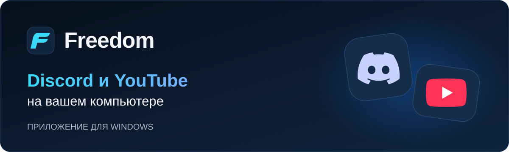

  

  <a href="https://freedom.com.ru/">Сайт</a> ·
  <a href="https://t.me/freeDomPassBot">Telegram-бот</a> ·
  <a href="https://github.com/kigl/freedom-releases/releases">Скачать приложение</a>

# Freedom

Freedom — сервис для доступа к Discord и YouTube через приложение для Windows. Регистрация, управление подпиской и получение ключа входа проходят в [Telegram-боте @freeDomPassBot](https://t.me/freeDomPassBot).

Одна учётная запись, одна активная установка. При переходе на другой компьютер можно получить новый ключ в боте: срок подписки сохранится, а прежняя установка отвяжется после входа на новом устройстве.

## Скачать и запустить

1. Откройте [Releases](https://github.com/kigl/freedom-releases/releases), выберите последний опубликованный выпуск и скачайте **`Freedom-win-x64.zip`** в разделе **Assets**.
2. Установите [.NET 10 Desktop Runtime для Windows x64](https://dotnet.microsoft.com/en-us/download/dotnet/10.0), если эта среда ещё не установлена.
3. Распакуйте архив целиком в отдельную папку и запустите **`Freedom.exe`**.
4. Откройте [бота](https://t.me/freeDomPassBot), зарегистрируйтесь, получите ключ и введите его в приложении.

Файлы `package.zip` и `release.manifest.json` используются для обновления приложения. Для первого запуска нужен `Freedom-win-x64.zip`. Файлы для скачивания появляются в Releases после публикации выпуска.

## Обновления

Нажмите **«Проверить обновления»** в приложении. Freedom скачает доступное обновление, проверит его и перезапустится. Вход и настройки сохраняются.

Текущий клиент включает вход по ключу, проверку подписки и обновление приложения. Управление подключением Discord и YouTube находится в разработке.

Подробнее о сервисе — на [freedom.com.ru](https://freedom.com.ru/). Регистрация и ключ — в [Telegram-боте](https://t.me/freeDomPassBot).
